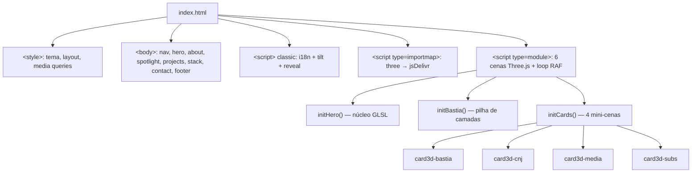
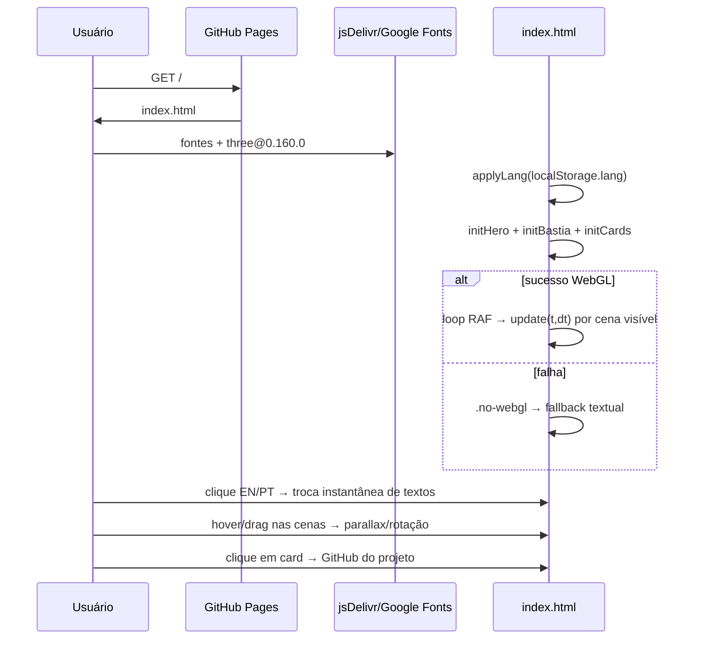

# Análise Técnica Completa — LeooMatheuss.github.io

Repositório: `LeooMatheuss/LeooMatheuss.github.io` · Branch: `main` · Data: 2026-11-08
Arquivos analisados: `index.html` (1240 linhas, 70,5 KB), `README.md` (136 linhas), `assets/` (2 PNGs de preview, ~1 MB).
Histórico: 8 commits no total — 5 autorais (Léo Matheus) e 3 do `devin-ai-integration[bot]` (cenas 3D do BastiaOS, mini-cenas nos cards, README).
Config do Pages: sem `CNAME` (domínio padrão `leoomatheuss.github.io`), sem workflows, sem `robots.txt`/`sitemap.xml`.

---

## 1. Resumo executivo

Site de portfólio pessoal de **Léo Matheus**, publicado via **GitHub Pages** a partir da branch `main`. É uma **página única, arquivo único**: todo o HTML, CSS e JavaScript vive em `index.html`. Não há backend, banco de dados, build, testes, CI ou gerenciador de pacotes. A única dependência externa de código é **Three.js r160** via CDN (jsDelivr, `importmap`), além de fontes do Google Fonts e ícones do Devicon.

O diferencial visual é um conjunto de **6 cenas WebGL/Three.js**: núcleo de energia no hero (shader GLSL próprio), pilha explodida de camadas do BastiaOS com drag-to-rotate, e 4 mini-cenas nos cards de projeto. O site é bilíngue (PT/EN) com preferência em `localStorage`.

## 2. Objetivo e propósito

Apresentar o perfil profissional do autor, sua stack técnica e seus projetos, com destaque especial para o **BastiaOS** (distribuição Linux própria). Funciona como cartão de visita: navegação âncora, sem formulários, sem dados dinâmicos.

## 3. Tecnologias utilizadas

| Tecnologia | Uso | Origem |
|---|---|---|
| HTML5 | Estrutura | Local |
| CSS3 (Grid, Flexbox, `backdrop-filter`, `@property`, `conic-gradient`, `mask-image`) | Estilo e animações | Local (`<style>` inline) |
| JavaScript ES Modules | i18n, tilt, observers, cenas 3D | Local (`<script>` inline) |
| Three.js 0.160.0 | 6 cenas WebGL, `ShaderMaterial` com GLSL próprio | CDN jsDelivr via `importmap` |
| GLSL (simplex noise + fresnel) | Shader do núcleo do hero | Inline |
| Google Fonts (Inter, JetBrains Mono) | Tipografia | CDN |
| Devicon (jsDelivr) | Ícones da stack | CDN |
| GitHub Pages | Hospedagem/deploy | Automático no push para `main` |

## 4. Arquitetura geral

Arquitetura **monolítica de arquivo único** — apropriada para um site estático, sem camadas formais. Três blocos dentro de `index.html`:



**Comunicação entre componentes:** não há módulos reais; as cenas compartilham utilitários (`makeRenderer`, `register`, `DOT`, `PURPLE`, `CYAN`, `NOISE`) e o array global `scenes`, iterado por um único loop `requestAnimationFrame`. Cada cena se registra via `register(canvas, renderer, scene, camera, update, onResize)`, que conecta `ResizeObserver` (resize) e `IntersectionObserver` (renderiza só quando visível).

**Tratamento de erros:** `makeRenderer` captura falha de criação do `WebGLRenderer`; se todas as cenas falharem, aplica `.no-webgl` no `<html>` e um timeout de 5s marca `no-webgl` caso o módulo Three.js não carregue (CDN fora). Fallback de texto da arquitetura do BastiaOS via `.spot-fallback`.

**Autenticação/autorização:** inexistente — site público e somente leitura.

**Configuração:** nenhuma; nenhuma variável de ambiente, arquivo de config ou `.env`.

## 5. Estrutura completa do repositório

```
.
├── index.html                  # Tudo: marcação, estilos, i18n, cenas 3D (1240 linhas)
├── README.md                   # Documentação com previews, instruções e personalização
└── assets/
    ├── preview-bastiaos.png    # Screenshot da seção BastiaOS (usado no README)
    └── preview-hero.png        # Screenshot do hero (usado no README)
```

Sem `.gitignore`, sem licença, sem CI, sem testes, sem `package.json`, sem hooks de pre-commit.

## 6. Mapeamento dos módulos (blocos dentro de index.html)

| Bloco | Linhas | Responsabilidade |
|---|---|---|
| `<head>` + `<style>` | 1–296 | Meta, fontes, tema (`:root`), todos os estilos, media queries, `prefers-reduced-motion` |
| `<nav>` | 299–311 | Barra fixa com links âncora e botão de idioma |
| `.hero` | 313–331 | Hero com canvas `#hero3d`, pill de destaque, CTAs, scroll cue |
| `#about` | 333–352 | Texto sobre + info-card |
| `#bastiaos` | 354–391 | Spotlight BastiaOS: texto, features, CTAs, canvas `#bastia3d`, fallback |
| `#projects` | 393–489 | Grid de 9 project-cards (4 com canvas `.card-3d`) |
| `#stack` | 491–514 | 16 ícones de tecnologia via Devicon |
| `#contact` + `<footer>` | 516–535 | CTAs de contato e rodapé |
| Script i18n + tilt | 537–667 | Objeto `i18n`, `applyLang`, toggle, observer de reveal, tilt 3D dos cards |
| importmap + guard no-webgl | 668–673 | CDN do Three.js e detecção de falha |
| Script module Three.js | 674–1237 | Utilitários, shader, 6 cenas, loop de render |

## 7. Funcionalidades implementadas

### 7.1 Internacionalização PT/EN — IMPLEMENTADO
- Local: `index.html` linhas 537–642.
- Objeto `i18n` com ~50 chaves × 2 idiomas; atributos `data-i18n` (textContent), `data-i18n-html` (innerHTML) e `data-i18n-aria` (aria-label).
- `applyLang` atualiza `documentElement.lang`, todos os textos e salva em `localStorage('lang')`. Toggle `#langToggle`.
- Regra: chave ausente em um idioma → texto fica no idioma anterior (fallback silencioso é o texto já renderizado).

### 7.2 Hero 3D — IMPLEMENTADO
- Linhas 748–857. `IcosahedronGeometry` com `ShaderMaterial` customizado: vertex shader aplica deformação por `snoise` (simplex noise), fragment shader mistura roxo/ciano com fresnel. Camadas: blob sólido + wireframe aditivo, casca de icosaedro com nós, 2 anéis torus com satélites orbitando, campo de 2200 partículas.
- Reage a mouse (parallax com suavização) e scroll (desloca/escala o núcleo). Layout responsivo via `onResize` (posição/escala mudam em telas estreitas).

### 7.3 Spotlight BastiaOS 3D — IMPLEMENTADO
- Linhas 860–1002. 6 placas (`BoxGeometry`) com labels via `CanvasTexture`, gradiente roxo→ciano; octaedro wireframe ("lock") com glow; plano de "scan" animado; 260 partículas ascendentes.
- Interações: drag-to-rotate (pointerdown/move/up com clamp em X), expansão das camadas no hover, rotação automática após 2s de inatividade, modo `compact` em portrait.
- Fallback `.spot-fallback` textual quando WebGL indisponível.

### 7.4 Mini-cenas 3D nos 4 primeiros cards — IMPLEMENTADO
- Linhas 1004–1214. Cenas individuais por card: pilha de torus + lock (BastiaOS), hub octaedro com satélite orbital (CNJ), funil de partículas (MediaGrabber), forma de onda + barras (SubtitleStudio). Opacidade aumenta no hover; velocidade/amplitude reagem ao hover.
- Os 4 cards são clicáveis via `.card-link` absoluto (`<a>` cobrindo o card) e abrem o repositório.

### 7.5 Tilt 3D dos cards — IMPLEMENTADO
- Linhas 651–666. `pointermove` → `rotateX/rotateY/translateZ` + variáveis `--gx/--gy` para o reflexo `::after`. Só ativa com `hover:hover` e sem `prefers-reduced-motion`.

### 7.6 Animações de entrada (reveal) — IMPLEMENTADO
- Linhas 646–649 + CSS `.reveal`. `IntersectionObserver` adiciona `.visible` ao entrar na viewport. **Observação:** observer nunca faz `unobserve` — elementos re-ocultam? Não: uma vez `.visible`, permanece. Correto.

### 7.7 Fallback sem WebGL — IMPLEMENTADO
- Linhas 671–673, 238–242, 1219–1221. Timeout de 5s sem `window.__three3d` → `.no-webgl`; ou se as 3 inits retornarem false. Esconde canvases e mostra `.spot-fallback`.

### 7.8 Acessibilidade/performance — IMPLEMENTADO (parcial em motion)
- `prefers-reduced-motion`: congela o tempo (`t`) e zera `dt` — animações ficam paradas mas render continua; tilt desativado; animações CSS de borda/cue desligadas.
- `devicePixelRatio` limitado a 2; cenas só renderizam quando visíveis.
- `aria-label`s nos canvases/links, `aria-hidden` nos decorativos.

## 8. Fluxos operacionais



## 9. Banco de dados

**Inexistente.** O único estado persistido é `localStorage('lang')` ('pt'|'en'). Diagrama ER não se aplica.

## 10. APIs e integrações

Não há APIs internas nem backend. Integrações externas (todas somente-leitura, via GET estático):

| Recurso | Endpoint | Uso |
|---|---|---|
| Three.js 0.160.0 | `cdn.jsdelivr.net/npm/three@0.160.0/build/three.module.js` | ES Module via importmap |
| Google Fonts | `fonts.googleapis.com` / `fonts.gstatic.com` | Inter 400–800, JetBrains Mono 400/600 |
| Devicon | `cdn.jsdelivr.net/gh/devicons/devicon/icons/...` | 16 SVGs da stack |
| Links externos | GitHub repos, LinkedIn, mailto, BastiaOS-Site | Navegação (`target="_blank" rel="noopener"`) |

Nenhuma autenticação, nenhum webhook, nenhum payload — a tabela de endpoints pedida pelo prompt não se aplica.

## 11. Autenticação e autorização

Nenhuma. Site público sem área restrita, sessões ou usuários.

## 12. Segurança

Avaliação limitada à superfície de um site estático:

| Item | Estado |
|---|---|
| Autenticação/sessões | N/A |
| Injeção (SQLi, comandos) | N/A — sem backend |
| XSS | Baixo risco. `data-i18n-html` injeta `innerHTML` a partir do objeto `i18n` estático — hoje seguro, mas é um ponto a vigiar se textos vierem de fonte externa. |
| CSRF/SSRF/rate limit/CORS | N/A |
| Segredos | Nenhum no código. |
| Supply chain (CDN) | **Risco médio:** Three.js, fontes e ícones vêm de CDNs **sem SRI (`integrity`)** e sem pinning de integridade. Se jsDelivr for comprometido, código arbitrário roda na página. |
| Links externos | Todos com `rel="noopener"`. Correto. |
| Headers (CSP etc.) | Sem controle — GitHub Pages não permite CSP customizado. |
| Exposição de dados | E-mail pessoal exposto (intencional, é portfólio). |

## 13. Infraestrutura e execução

- **Instalação:** `git clone` — sem dependências para instalar.
- **Execução local:** precisa de servidor HTTP (ES Modules não rodam em `file://`): `python3 -m http.server 8080`. Requer internet (CDN).
- **Build:** nenhum.
- **Deploy:** GitHub Pages automático no push para `main`. Sem Actions, sem CI.
- **Portas:** a que o servidor estático usar.
- **Testes:** não existem.
- **Docker:** não existe (desnecessário para site estático).

## 14. Testes e qualidade

**Cobertura de testes: zero** — aceitável para portfólio, mas sem nenhuma verificação automatizada (nem lint, nem validação HTML).

Qualidade do código:
- **Organização:** razoável — blocos bem delimitados e comentados por seção, mas tudo em um arquivo de 1240 linhas.
- **Legibilidade:** boa; nomes descritivos.
- **Reutilização:** boa (`makeRenderer`, `register`, `dotTexture`, `NOISE`, constantes de cor).
- **Duplicação:** as 4 mini-cenas repetem o mesmo padrão (grupo à direita, hover flags, lookAt) — poderiam ser fatoradas, mas o custo é baixo.
- **Acoplamento/cohesão:** cada cena é auto-contida; adequado.
- **Observabilidade/logs:** nenhuma (erros de WebGL silenciosos por design).
- **Performance:** bem cuidada (IntersectionObserver, DPR cap, resize observer). Ponto de atenção: com `prefers-reduced-motion` o loop continua renderizando a cada frame com `dt=0` — desperdiça GPU; poderia renderizar um único frame.

## 15. Problemas identificados

1. **CDNs sem SRI** (médio): `importmap` do Three.js e `link` de fontes sem `integrity`/pin rigoroso.
2. **Timeout de 5s para detectar falha da CDN** (baixo): em rede lenta pode marcar `no-webgl` mesmo com módulo prestes a carregar; não há retry.
3. **`i18n` chaves ausentes falham silenciosamente** (baixo): `if (i18n[l][key])` — chave faltando deixa texto no idioma anterior sem aviso.
4. **`info.repos` hardcoded "37+"** (baixo): a API do GitHub reporta **38 repositórios públicos** hoje — o número já está levemente desatualizado e continuará defasando.
5. **Sem `lang` dinâmico para `<title>`/meta description** (baixo): título e description ficam em inglês mesmo em PT.
6. **Loop RAF sempre ativo** (baixo): mesmo fora de `prefers-reduced-motion`, cada cena fora de vista é pulada, mas o loop roda sem condição de saída — impacto pequeno.
7. **`data-i18n-html` usa innerHTML** (informativo): seguro hoje, frágil no futuro.
8. **Sem licença, sem `.gitignore`, sem CI** (informativo).

## 16. Funcionalidades incompletas

Busca por TODO/FIXME/mocks/funções vazias/botões sem ação: **nenhum encontrado**. Todos os links e botões têm destino funcional. O único placeholder intencional é `.spot-fallback` (funcional, é o fallback correto).

## 17. Dívidas técnicas

| Dívida | Impacto | Esforço |
|---|---|---|
| Monólito de 1240 linhas | Dificulta manutenção incremental e code review | Médio (extrair CSS/JS) |
| Sem CI/lint/format | Erros de sintaxe só aparecem em produção | Baixo |
| Sem SRI nos CDNs | Risco de supply chain | Baixo |
| i18n sem validação de paridade de chaves | Traduções inconsistentes silenciosas | Baixo |
| Partículas/cenas recriadas por `register` sem dispose | Vazamento se canvases fossem recriados (não ocorre hoje) | Baixo |

## 18. Limitações atuais

- Depende 100% de internet em runtime (CDN) — offline não funciona além do fallback.
- Sem conteúdo dinâmico: projetos, stats e textos são hardcoded.
- Sem formulário de contato, analytics ou SEO estruturado (Open Graph/Twitter Cards ausentes).
- Sem sitemap/robots.txt (GitHub Pages serve defaults).

## 19. Oportunidades de melhoria

1. Adicionar meta tags Open Graph/Twitter Card com a imagem de preview.
2. Adicionar `integrity` + `crossorigin` no importmap (ou hospedar three.js localmente em `assets/`).
3. Extrair CSS e JS para arquivos próprios (ou manter, se o objetivo for single-file — é uma decisão de estilo válida).
4. CI mínima: GitHub Action com validação HTML/link-checker.
5. Paridade de chaves i18n checada por script; traduzir `<title>` e `meta description`.
6. Buscar contagem de repos via GitHub API (com cache) em vez de "37+" fixo.
7. Reduzir o timeout de fallback ou detectar falha de carregamento do módulo diretamente (`window.addEventListener('error')` no script module).
8. Em `prefers-reduced-motion`, renderizar um frame estático em vez de loopar com `dt=0`.

## 20. Roadmap técnico recomendado

| Prioridade | Ação |
|---|---|
| Alta | SRI/pinning de CDN; meta OG/Twitter; título/description traduzidos |
| Média | CI de validação; checagem de paridade i18n; extrair assets críticos para o repo |
| Baixa | Fatorar padrão comum das mini-cenas; `unobserve` pós-reveal; dispose explícito de renderers; `robots.txt`/`sitemap.xml` |

---

## Matriz de implementação

| Funcionalidade | Módulo | Status | Evidência no código | Pendências |
|---|---|---|---|---|
| Layout/página única | `index.html` | IMPLEMENTADO | seções nav→footer, linhas 298–535 | — |
| i18n PT/EN | script linhas 537–642 | IMPLEMENTADO | objeto `i18n`, `applyLang`, toggle, `localStorage` | paridade de chaves não validada; título/meta não traduzidos |
| Hero 3D (shader) | `initHero()` 748–857 | IMPLEMENTADO | `ShaderMaterial` GLSL, anéis, partículas, parallax | — |
| Spotlight BastiaOS 3D | `initBastia()` 860–1002 | IMPLEMENTADO | placas, labels canvas, drag, scan, partículas | — |
| Mini-cenas nos cards | `initCards()` 1004–1214 | IMPLEMENTADO | 4 IIFEs, uma por card | padrão duplicado |
| Cards clicáveis | `.card-link` | IMPLEMENTADO | `<a>` absoluto nos 4 primeiros cards | cards 5–9 só têm link ↗ |
| Tilt 3D dos cards | linhas 651–666 | IMPLEMENTADO | pointermove → rotate + `--gx/--gy` | — |
| Reveal on scroll | linhas 646–649 + CSS | IMPLEMENTADO | IntersectionObserver | sem unobserve (impacto mínimo) |
| Fallback sem WebGL | linhas 671–673, 238–242 | IMPLEMENTADO | `.no-webgl`, `.spot-fallback`, timeout 5s | timeout pode gerar falso negativo em rede lenta |
| prefers-reduced-motion | linha 292, 677, 1227 | IMPLEMENTADO | congela `t`, desliga tilt/animações CSS | loop continua gastando GPU |
| Responsividade | media queries 281–295 | IMPLEMENTADO | breakpoint 768px, `compact` na cena Bastia | apenas um breakpoint |
| Deploy | GitHub Pages | IMPLEMENTADO | README §Deploy; branch `main` | — |
| Backend/banco/APIs | — | NÃO IMPLEMENTADO | não aplicável ao escopo | — |
| Testes automatizados | — | NÃO IMPLEMENTADO | nenhum arquivo de teste | — |
| CI/lint | — | NÃO IMPLEMENTADO | sem workflows | — |
| SEO (OG/sitemap/robots) | `<head>` | PARCIALMENTE IMPLEMENTADO | meta description + title existem | faltam OG/Twitter, sitemap, robots |
| Segurança CDN (SRI) | importmap/links | NÃO IMPLEMENTADO | sem `integrity` | adicionar SRI ou self-host |

---

**Nota de conduta:** nenhum arquivo foi modificado; análise somente de leitura. Aguardando autorização antes de qualquer alteração de código.
