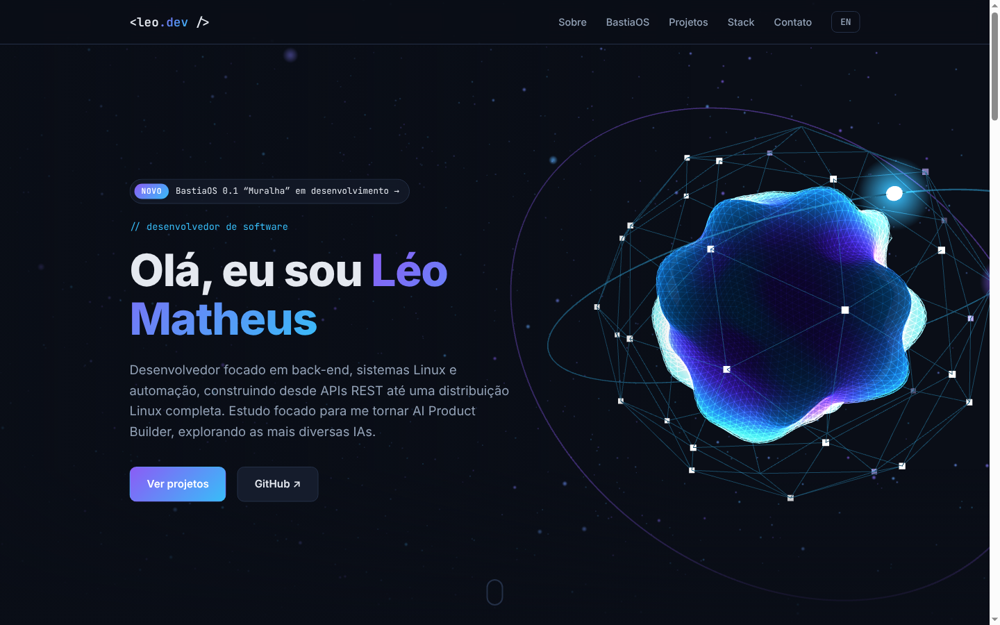
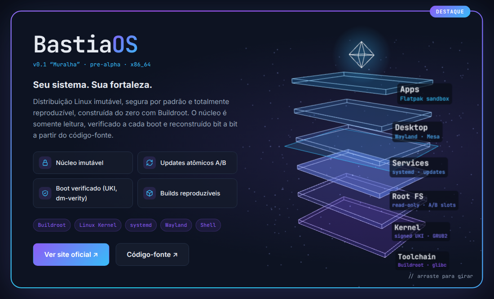

<div align="center">

# &lt;leo.dev /&gt;

### Portfólio pessoal de **Léo Matheus**, desenvolvedor de software

Back-end · Sistemas Linux · Automação · AI Product Building

[](https://leoomatheuss.github.io/)
[](#stack)
[](#stack)
[](#stack)
[](https://threejs.org/)
[](#internacionalização)

**[Acessar o site →](https://leoomatheuss.github.io/)**



</div>

---

## Sobre

Portfólio de página única que apresenta meu perfil, meus principais projetos e minha stack técnica. O site foi pensado para causar impacto logo na primeira dobra, com cenas 3D interativas em **Three.js**, e mesmo assim continuar leve: é um único arquivo HTML, sem build, sem framework e sem dependências instaladas.

## Destaques

- **Hero 3D interativo**: um núcleo de energia com shader GLSL próprio (deformação por *simplex noise* e brilho *fresnel*), malha em wireframe, anéis orbitais e um campo de partículas. A cena reage ao movimento do mouse (parallax) e ao scroll.
- **Spotlight do BastiaOS**: seção dedicada à minha distribuição Linux, com a arquitetura em camadas representada em uma **visualização 3D explodida** (Toolchain → Kernel → Root FS → Services → Desktop → Apps). Ela tem rotação por arraste, expansão das camadas no hover e uma animação de "boot verificado".
- **Cards de projeto com tilt 3D**: inclinação e reflexo de luz que acompanham o cursor. Os projetos principais (BastiaOS e CNJ Publications Intelligence) aparecem em destaque.
- **Bilíngue (PT/EN)**: troca de idioma instantânea, com a preferência salva no `localStorage`.
- **Responsivo**: layout adaptado para desktop, tablet e celular.

<div align="center">

</div>

## Performance e acessibilidade

| Recurso | Implementação |
|---|---|
| Renderização sob demanda | Cada cena WebGL só renderiza quando está visível na tela (`IntersectionObserver`). |
| Custo de GPU controlado | `devicePixelRatio` limitado a 2 e resize via `ResizeObserver`. |
| Movimento reduzido | Com `prefers-reduced-motion` as animações automáticas são congeladas e os efeitos de hover são desativados. |
| Fallback sem WebGL | Se o navegador não suportar WebGL ou a CDN falhar, a página aplica `.no-webgl` e mostra uma versão em texto da arquitetura. |
| Zero build | Three.js carregado como ES Module via `importmap` (jsDelivr). |

## Stack

- **HTML5 + CSS3**: layout com Grid/Flexbox, variáveis CSS, `@property` para a borda em gradiente animada e `backdrop-filter`.
- **JavaScript (ES Modules)**: i18n, animações de entrada, tilt dos cards.
- **[Three.js](https://threejs.org/) r160**: cenas 3D, `ShaderMaterial` com GLSL próprio, sprites e partículas.
- **GitHub Pages**: hospedagem e deploy contínuo a partir da branch `main`.

## Estrutura

```
.
├── index.html      # Página completa: estrutura, estilos, i18n e cenas Three.js
├── assets/         # Imagens usadas neste README
└── README.md
```

Dentro do `index.html`:

| Bloco | Responsabilidade |
|---|---|
| `<style>` | Tema (variáveis em `:root`), seções, spotlight, tilt e media queries |
| `#hero3d` | Canvas do hero (núcleo, anéis, partículas) |
| `#bastiaos` / `#bastia3d` | Spotlight do BastiaOS e pilha de camadas 3D |
| `#projects` | Grid de projetos (`.project-card`, `.featured`) |
| `const i18n` | Textos em português e inglês |
| `<script type="module">` | Inicialização e loop de renderização do Three.js |

## Rodando localmente

Por usar ES Modules, o site precisa ser servido via HTTP (abrir o arquivo direto com `file://` não funciona):

```bash
git clone https://github.com/LeooMatheuss/LeooMatheuss.github.io.git
cd LeooMatheuss.github.io
python3 -m http.server 8080
# acesse http://localhost:8080
```

Qualquer servidor estático serve (`npx serve`, extensão Live Server do VS Code etc.). É necessário acesso à internet para carregar Three.js e as fontes.

## Personalização

### Adicionar um projeto

Copie um bloco `.project-card` dentro de `.projects-grid`. Para destacá-lo, adicione a classe `featured` e o selo:

```html
<div class="project-card featured">
  <span class="featured-badge" data-i18n="featured">DESTAQUE</span>
  <div class="project-head">
    <span class="project-name">meu-projeto</span>
    <a href="https://github.com/LeooMatheuss/meu-projeto" target="_blank" rel="noopener" class="project-link">↗</a>
  </div>
  <p class="project-desc" data-i18n="p9.desc">Descrição em português.</p>
  <div class="tags"><span class="tag">Node.js</span></div>
</div>
```

### Internacionalização

Todo texto traduzível usa `data-i18n="chave"` (texto puro) ou `data-i18n-html="chave"` (com HTML). Adicione a mesma chave nos dois idiomas do objeto `i18n`:

```js
const i18n = {
  pt: { 'p9.desc': 'Descrição em português.' },
  en: { 'p9.desc': 'English description.' }
};
```

### Tema

As cores ficam centralizadas em `:root` (`--accent`, `--accent-2`, `--gradient`). As cenas 3D usam as constantes `PURPLE` e `CYAN` no módulo Three.js.

## Deploy

O site é publicado automaticamente pelo **GitHub Pages** a cada push na branch `main`, sem nenhuma etapa de build.

## Contato

- **LinkedIn**: [Leonardo Matheus da Silva](https://www.linkedin.com/in/leonardo-matheus-da-silva-1126b8a0/)
- **E-mail**: [leoomatheus@outlook.com.br](mailto:leoomatheus@outlook.com.br)
- **GitHub**: [@LeooMatheuss](https://github.com/LeooMatheuss)

<div align="center">
<sub>© Léo Matheus · Santa Catarina, Brasil</sub>
</div>
